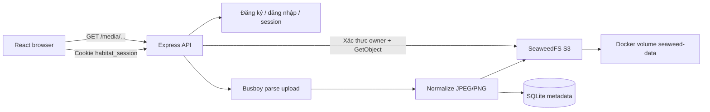

# Habitat Stories - Backend và ứng dụng Gallery

Tài liệu dành cho người đọc/mở rộng phía backend. Phần này mô tả đúng luồng code đang chạy, dữ liệu lưu ở đâu, API cần cookie nào, giới hạn đã có và cách kiểm thử từ đăng ký đến upload/xóa ảnh.

## Tổng quan

Habitat Stories là ứng dụng React/Express lưu hai loại dữ liệu:

| Dữ liệu | Nơi lưu |
| --- | --- |
| Tài khoản, cookie phiên, metadata ảnh, key object, cleanup | SQLite `.data/gallery.sqlite` |
| Ảnh gốc PNG và variant WebP | SeaweedFS S3 gateway |
| Avatar 256 px | BLOB trong bảng `User` |
| Ảnh giao diện tĩnh | `public/` và bản build `dist/` |

Luồng chính:



Mỗi user chỉ xem, sửa, xóa và tải media của chính ảnh user đó. Ảnh cũ không gắn `user_id` đã bị xóa khỏi gallery hiện tại.

---

## Công nghệ

| Thành phần | Công nghệ |
| --- | --- |
| Frontend | React 19, React DOM, Vite 7 |
| Routing frontend | Dựa trên `window.location.pathname` |
| Backend | Node.js 24+, Express 5 |
| Database | Node `node:sqlite`, SQLite WAL |
| Object storage | SeaweedFS qua AWS SDK S3-compatible |
| Xử lý ảnh | Sharp |
| Multipart | Busboy |
| Biểu mẫu đăng nhập | Fetch API/FormData, HttpOnly cookie |
| Chỉnh sửa ảnh | react-easy-crop |

Thư mục:

```text
src/          React components và CSS
server/       Express, authentication, SQLite, S3, cleanup
scripts/      Fixture, cleanup, storage smoke, database inspect
public/       Ảnh tĩnh gốc của frontend
dist/         Output Vite; tạo lại bằng npm run build
.data/        SQLite và fixture kiểm thử, không commit
```

`public/` là nguồn asset tĩnh. `dist/` là thư mục build sinh ra, không sửa trực tiếp. Khi chạy production, Express có thể phục vụ `dist/`; khi chạy development, Vite phục vụ `public/`.

---

## Chạy ứng dụng

Yêu cầu:

- Node.js 24 trở lên
- npm
- Docker Desktop đang chạy

```bash
npm install
cp .env.example .env
npm run storage:up
npm run dev
```

Địa chỉ mặc định:

| Mục | Địa chỉ |
| --- | --- |
| Frontend dev | `http://127.0.0.1:5173` |
| API dev | `http://127.0.0.1:3001` |
| SeaweedFS S3 | `http://127.0.0.1:8333` |

Vite proxy `/api` và `/media` sang API. Trong production:

```bash
npm run build
npm start
```

Sau đó mở `http://127.0.0.1:3001`. Dừng Docker nhưng giữ dữ liệu:

```bash
npm run storage:down
```

Không dùng `docker compose down -v` nếu không muốn xóa SeaweedFS volume.

---

## Cấu hình

File `.env.example`:

```dotenv
PORT=3001
S3_ENDPOINT=http://127.0.0.1:8333
S3_REGION=us-east-1
S3_BUCKET=moments
S3_ACCESS_KEY=gallery-local
S3_SECRET_KEY=gallery-local-secret
DATABASE_PATH=.data/gallery.sqlite
COOKIE_SECURE=false
```

| Biến | Ý nghĩa |
| --- | --- |
| `PORT` | Cổng Express |
| `S3_ENDPOINT` | Địa chỉ SeaweedFS S3 |
| `S3_REGION` | Region gửi cho SDK; mặc định local |
| `S3_BUCKET` | Bucket chứa ảnh |
| `S3_ACCESS_KEY` / `S3_SECRET_KEY` | Credential local của SeaweedFS |
| `DATABASE_PATH` | File SQLite |
| `COOKIE_SECURE` | `true` khi chạy HTTPS; `false` khi chạy HTTP local |

Ứng dụng tạo bucket tự động nếu chưa tồn tại.

---

## Tài khoản và phiên

### Cookie session

Khi đăng nhập hoặc đăng ký, server tạo:

- 32 byte ngẫu nhiên làm session token.
- Cookie `habitat_session`.
- Chỉ lưu SHA-256 của token trong `UserSession.token_hash`.
- Cookie `HttpOnly`, `SameSite=Lax`, `Path=/`.
- Không lưu raw session token trong SQLite hoặc localStorage.

| Loại phiên | Thời hạn |
| --- | --- |
| Không ghi nhớ | 12 giờ |
| Ghi nhớ đăng nhập | 30 ngày |

Đăng nhập mới có thể thay phiên trước đó đang lưu trong cookie. Đăng xuất xóa cookie và row phiên tương ứng.

### Mật khẩu

- Đăng ký tối thiểu 15 ký tự, tối đa 128.
- Login không áp dụng độ dài tối thiểu ngoài giới hạn 128.
- Hash bằng `scrypt`: `N=131072`, `r=8`, `p=1`.
- Salt 16 byte độc lập cho mỗi tài khoản.
- Không trả `password_hash` qua API.

### Quy tắc xác thực

Các route upload, danh sách ảnh, chi tiết, media, edit/restore và delete đều gọi session hiện tại.

Nếu không đăng nhập:

- API trả `401 { "message": "Vui lòng đăng nhập để sử dụng gallery." }`.
- Frontend chuyển sang `/login`.
- Không trả ảnh của tài khoản khác.

Nếu ảnh thuộc tài khoản khác hoặc không tồn tại:

- Các route detail/edit/delete/media thường trả `404`.
- Không tiết lộ ảnh có tồn tại hay không.

---

## API tài khoản

Tất cả response dưới `/api/auth` dùng `Cache-Control: no-store`.

| Method | URL | Request | Response |
| --- | --- | --- | --- |
| `POST` | `/api/auth/register` | JSON | `201 { user }` + cookie |
| `POST` | `/api/auth/login` | JSON | `200 { user }` + cookie |
| `GET` | `/api/auth/me` | Không | `200 { user }` hoặc `{ user: null }` |
| `POST` | `/api/auth/logout` | JSON `{}` | `204` |
| `PUT` | `/api/auth/avatar` | Multipart `avatar` | `200 { user }` |
| `GET` | `/api/auth/avatar/:version` | Không | Avatar WebP của user |

JSON tài khoản tối đa 8 KiB. Avatar tối đa:

- 5 MiB
- JPG/PNG/WebP
- 16 triệu pixel

Server chuẩn hóa avatar thành 256x256 WebP trong SQLite BLOB. `avatar_version` thay đổi khi avatar được thay.

---

## Schema SQLite

### `User`

```text
id
name
email
password_hash
created_at
avatar_data
avatar_version
```

Email trim và chuyển thường, cột `UNIQUE COLLATE NOCASE`.

### `UserSession`

```text
token_hash
user_id
expires_at
```

### `Photo`

```text
id
title
alt
created_at
status
current_version
next_version
original_storage_key
original_width
original_height
user_id
```

Quan hệ: `Photo.user_id -> User.id`.

### `PhotoVariant`

```text
photo_id
version
width
height
mime
bytes
storage_key
```

Primary key: `(photo_id, version, width)`.

### `CleanupJob`

```text
storage_key
photo_id
available_at
attempts
last_error
```

Schema tự tạo và nâng cấp khi server khởi động.

---

## API gallery

| Method | URL | Quyền | Response |
| --- | --- | --- | --- |
| `POST` | `/api/photos` | Đăng nhập | Upload multipart |
| `GET` | `/api/photos` | Đăng nhập | Chỉ ảnh của user |
| `GET` | `/api/photos/:id` | Chủ sở hữu | Metadata ảnh |
| `DELETE` | `/api/photos/:id` | Chủ sở hữu | `204` hoặc `202` |
| `POST` | `/api/photos/:id/edit` | Chủ sở hữu | Version mới |
| `POST` | `/api/photos/:id/restore` | Chủ sở hữu | Khôi phục từ bản gốc |
| `GET` | `/media/photos/:id/:filename` | Chủ sở hữu | Variant v1 hoặc bản gốc |
| `GET` | `/media/photos/:id/:version/:filename` | Chủ sở hữu | Variant version cụ thể |
| `GET` | `/api/health` | Public | Trạng thái SeaweedFS |

### Response ảnh

```json
{
  "id": "UUID",
  "title": "Tiêu đề",
  "alt": "Mô tả",
  "createdAt": "ISO timestamp",
  "status": "published",
  "currentVersion": 1,
  "userId": "USER_UUID",
  "original": {
    "width": 1800,
    "height": 1200,
    "url": "/media/photos/UUID/original.png"
  },
  "variants": [
    {
      "width": 320,
      "height": 213,
      "mime": "image/webp",
      "bytes": 12345,
      "url": "/media/photos/UUID/v1/320.webp"
    }
  ]
}
```

Media trả:

```http
Content-Type: image/webp | image/png
Cache-Control: public, max-age=31536000, immutable
X-Content-Type-Options: nosniff
```

Metadata gallery dùng `Cache-Control: no-store`.

---

## Upload multipart

Một request cần:

| Field | Quy tắc |
| --- | --- |
| `title` | 1-200 ký tự, trim |
| `alt` | 1-500 ký tự, trim |
| `photos` | 1-5 file, field name phải là `photos` |

Ví dụ browser:

```js
const form = new FormData();
form.append('title', 'Bờ biển');
form.append('alt', 'Sóng nhỏ lúc chiều');
form.append('photos', file);

const response = await fetch('/api/photos', {
  method: 'POST',
  body: form,
});
```

Không tự set `Content-Type: multipart/form-data`; browser tạo boundary.

### Giới hạn

| Giới hạn | Hành vi |
| --- | --- |
| File nén | Tối đa 10 MiB |
| Toàn request | Tối đa 55 MiB |
| Số file | 1-5 |
| File hợp lệ | JPEG/PNG tĩnh |
| Pixel | Tối đa 40 triệu |
| Chiều variant | 320, 960, 1600, không phóng nhỏ |
| Cùng lúc | Một lượt upload/edit trong process |

Parser dùng signature và Sharp để xác thực, không tin MIME hoặc phần mở rộng do client gửi.

Một ảnh quá 10 MiB hoặc sai định dạng không làm toàn bộ request thất bại. Nó được trả trong `results` với `status: rejected`.

Response upload:

```json
{
  "results": [
    {
      "index": 0,
      "name": "bien.jpg",
      "status": "accepted",
      "photo": {}
    },
    {
      "index": 1,
      "name": "fake.jpg",
      "status": "rejected",
      "error": {
        "code": "INVALID_IMAGE",
        "message": "Ảnh hỏng..."
      }
    }
  ]
}
```

`index` bắt đầu từ 0. Các lỗi file:

- `FILE_TOO_LARGE`
- `INVALID_IMAGE`
- `SAVE_FAILED`

### Xử lý ảnh

Sharp:

1. Kiểm tra JPEG/PNG.
2. Giải mã tối đa 40 triệu pixel.
3. Áp dụng EXIF orientation.
4. Xóa EXIF/GPS.
5. Tạo bản gốc PNG đã chuẩn hóa.
6. Tạo các variant 320/960/1600 WebP chất lượng 82.
7. Không tăng chiều khi ảnh gốc nhỏ hơn.

Ví dụ ảnh gốc 800 px rộng tạo variant 320 px và 800 px, không tạo 960/1600.

---

## Luồng upload có bù trừ

Upload không ghi trực tiếp rồi commit DB ngẫu nhiên. Trình tự:

1. Chuẩn hóa ảnh, sinh UUID và storage keys.
2. Ghi `CleanupJob` cho mọi key dự kiến.
3. PUT bản gốc và variant lên SeaweedFS.
4. Transaction SQLite:
   - Insert `Photo`
   - Insert `PhotoVariant`
   - Xóa cleanup jobs của upload
   - Commit
5. Chỉ sau commit mới trả ảnh accepted.

Nếu một PUT timeout dù object có thể đã được ghi, key đó được giữ trong cleanup để lần sau được dọn.

Nếu DB publish lỗi:

- Release lease cleanup.
- Gọi cleanup.
- Nếu cleanup lỗi, giữ job trong SQLite.
- Ghi log `cleanup_required` kèm key để xử lý thủ công.

Chưa có daemon hoặc cron cleanup. Chạy:

```bash
npm run cleanup
```

---

## Luồng chỉnh sửa và khôi phục

`POST /api/photos/:id/edit` nhận JSON:

```json
{
  "expectedVersion": 1,
  "crop": {
    "x": 100,
    "y": 80,
    "width": 600,
    "height": 400
  },
  "rotation": 90,
  "flip": true
}
```

Server kiểm tra:

- `crop` là số nguyên nằm trong kích thước bản gốc.
- `rotation` thuộc `0, 90, 180, 270`.
- `flip` là boolean.
- `expectedVersion` bằng version đang công bố.

Thứ tự xử lý:

```text
crop bản gốc
-> xoay theo chiều kim đồng hồ
-> lật ngang
-> tạo variant mới
```

Sau khi lưu:

- Variant mới nằm tại `photos/<UUID>/vN/<width>.webp`.
- `Photo.current_version` thay đổi trong transaction.
- Variant cũ được đưa vào cleanup sau retention 24 giờ.
- `original` không đổi.

Nếu hai tab sửa cùng lúc, một request trả `409` và yêu cầu đóng/mở lại ảnh.

`POST /api/photos/:id/restore` chỉ nhận `{ "expectedVersion": N }`, tạo một version mới từ bản gốc PNG đã chuẩn hóa.

Ảnh cũ không có bản gốc chuẩn hóa sẽ không cho edit/restore.

---

## Luồng xóa

Delete không xóa metadata ngay trong mọi trường hợp:

1. Transaction đổi `Photo.status = deleting`.
2. Ghi key original và mọi variant vào `CleanupJob`.
3. Dọn từng object khỏi SeaweedFS.
4. Sau khi object cuối cùng biến mất, xóa Photo và variant metadata.

API:

- `204`: dọn xong.
- `202`: ảnh đã ẩn nhưng còn object cleanup lỗi.
- `404`: ảnh không thuộc user hoặc không tồn tại.

List/detail/media sẽ không tiếp tục trả ảnh kể cả khi cleanup thất bại.

---

## SQLite và SeaweedFS

Xem nhanh database và object:

```bash
npm run storage:list
```

Nếu cài sqlite3 CLI:

```bash
sqlite3 .data/gallery.sqlite 'SELECT id, title, alt, status, user_id FROM Photo;'
sqlite3 .data/gallery.sqlite 'SELECT id, name, email, created_at FROM User;'
sqlite3 .data/gallery.sqlite 'SELECT photo_id, version, width, height, storage_key FROM PhotoVariant;'
sqlite3 .data/gallery.sqlite 'SELECT * FROM CleanupJob;'
sqlite3 .data/gallery.sqlite 'SELECT token_hash, user_id, expires_at FROM UserSession;'
```

Không lưu mật khẩu thô. Không lưu raw session token.

Kiểm tra object trong bucket:

```bash
curl -I http://127.0.0.1:3001/api/health
curl http://127.0.0.1:3001/api/photos
```

---

## Test luồng user A-Z

### 1. Chạy đăng ký và đăng nhập

Mở:

```text
http://127.0.0.1:5173/register
```

Tạo user A. Sau đăng ký, kiểm tra:

- Được chuyển về `/`.
- Thanh điều hướng hiển thị avatar/tên.
- Không còn nút Đăng nhập.
- Upload và Gallery hoạt động.

Đăng xuất và đăng ký user B. Kiểm tra gallery của B rỗng.

### 2. Kiểm tra chưa đăng nhập

Không có cookie session:

- Mở `/`.
- Bấm Upload hoặc Add Story hoặc Gallery.
- App chuyển tới `/login`.
- Gọi API thủ công phải nhận `401`.

```bash
curl -i http://127.0.0.1:3001/api/photos
```

### 3. Test đăng nhập bằng curl

```bash
curl -c /tmp/habitat.cookies \
  -H 'Content-Type: application/json' \
  -d '{"email":"a@example.com","password":"MatKhauA123456789","remember":true}' \
  http://127.0.0.1:3001/api/auth/login
```

Kiểm tra session:

```bash
curl -b /tmp/habitat.cookies http://127.0.0.1:3001/api/auth/me
```

Upload:

```bash
curl -b /tmp/habitat.cookies \
  -F 'title=Bai thu nghiem' \
  -F 'alt=Anh JPEG hop le' \
  -F 'photos=@.data/fixtures/valid.jpg' \
  -F 'photos=@.data/fixtures/fake.jpg' \
  http://127.0.0.1:3001/api/photos
```

List gallery:

```bash
curl -b /tmp/habitat.cookies http://127.0.0.1:3001/api/photos
```

Lấy ID từ response rồi xem, sửa hoặc xóa.

### 4. Kiểm tra tài khoản A không xem ảnh B

1. Đăng nhập user A, upload 1 ảnh.
2. Ghi lại photo ID và variant URL.
3. Đăng xuất.
4. Đăng nhập user B.
5. `GET /api/photos` không có ảnh A.
6. Gọi detail/media/delete bằng photo ID của A; kỳ vọng `404`.

### 5. Kiểm tra logout

```bash
curl -i -b /tmp/habitat.cookies \
  -H 'Content-Type: application/json' \
  -d '{}' \
  -X POST http://127.0.0.1:3001/api/auth/logout
```

Sau đó:

```bash
curl -b /tmp/habitat.cookies http://127.0.0.1:3001/api/auth/me
```

Kỳ vọng `{ "user": null }`.

---

## Test tự động

```bash
npm test
npm run build
npm run test:storage
npm run test:storage -- --restart-storage
```

### `npm test`

Chạy server test bằng Node `node --test`:

- SQLite riêng trong memory hoặc thư mục tạm.
- HTTP server tạm.
- SeaweedFS S3 thay bằng storage giả trong RAM.
- Fault injection cho PUT, DB commit, DELETE.
- Auth, login/logout, session, avatar.
- Upload multipart và giới hạn.
- EXIF/variant.
- Edit/crop/rotate/flip/restore.
- Retry cleanup.

Chạy 40 test hiện tại không cần Docker.

### `npm run test:storage`

Test tích hợp SeaweedFS thật:

- Tạo temporary SQLite.
- Upload fixture.
- Kiểm tra object và media.
- Restart API.
- Dọn bằng delete.
- Inject DB/DELETE lỗi.
- Xóa chỉ object được test tạo.

Chạy script này:

```bash
npm run storage:up
npm run test:storage
```

Script có giới hạn hiện tại: upload smoke cần cookie đăng nhập hợp lệ vì API upload đã yêu cầu session. Nếu chạy script nội bộ, cần bổ sung helper tạo/đăng nhập test user trong script hoặc truyền cookie test.

### Fixtures

Tạo fixture:

```bash
npm run fixtures
```

Các file mẫu trong `.data/fixtures/`:

- `valid.jpg`: JPEG hợp lệ.
- `valid.png`: PNG hợp lệ.
- `orientation-gps.jpg`: EXIF orientation và GPS.
- `fake.jpg`: text có đuôi jpg.
- `truncated.jpg`: JPEG bị cắt.
- `over-10MiB.jpg`: JPEG vượt giới hạn.
- `over-40MP.png`: PNG vượt giới hạn pixel.

Không dùng fixture làm ảnh production.

---

## Kiểm tra storage thủ công

Sau khi upload:

```bash
npm run storage:list
```

Đầu ra bao gồm:

- Hàng `Photo`
- Hàng `PhotoVariant`
- Hàng `CleanupJob`
- Key và bytes trong bucket

Đối chiếu:

```text
Photo.id == photoId trong URL
PhotoVariant.photo_id == Photo.id
PhotoVariant.storage_key == key trong SeaweedFS
Photo.user_id == User.id đang login
```

Xem object raw:

```bash
curl -I -b /tmp/habitat.cookies \
  http://127.0.0.1:3001/media/photos/PHOTO_ID/v1/320.webp
```

---

## Giới hạn hiện tại

Mục này cần biết khi mở rộng hoặc deploy:

- Ứng dụng local, không phải multi-server production.
- Bộ đếm đăng nhập/rate limit lưu trong RAM process.
- Chỉ một upload/edit đang chạy tại một thời điểm trong một process.
- Chưa có Redis hoặc queue xử lý ảnh.
- Cleanup chưa có scheduler tự động.
- Chưa verify email.
- Chưa OAuth Apple/Google/X.
- Chưa quên mật khẩu bằng email; `/forgot-password` là placeholder.
- Chưa có sharing hoặc album.
- Chưa có CDN.
- Chưa có soft delete cho user.
- Chưa có pagination cho `/api/photos`.
- Chưa có quota dung lượng theo user.
- SeaweedFS local không thay thế backup production.
- Media cache browser có thể giữ ảnh cũ dù đã delete origin.
- Public file trong `public/` là asset giao diện, không phải ảnh gallery của user.
- `dist/` không commit và không nên sửa thủ công.

---

## Troubleshooting

### API 503 storage disconnected

```bash
docker compose ps
npm run storage:up
docker compose logs --tail=30 seaweedfs
curl http://127.0.0.1:3001/api/health
```

### Upload 401

Người dùng chưa đăng nhập hoặc cookie đã hết.

```bash
curl -b /tmp/habitat.cookies http://127.0.0.1:3001/api/auth/me
```

### Upload/GET bị 403

Kiểm tra request origin. Dev origin phải là `http://127.0.0.1:5173`; production từ origin khác có thể bị chặn bởi middleware.

### DB không có ảnh cũ

Ảnh chung cũ không gắn user đã được dọn. Chỉ ảnh upload sau migration mới gắn `user_id`.

### DB và object không khớp

Chạy:

```bash
npm run storage:list
npm run cleanup
npm run storage:list
```

Không xóa `.data/gallery.sqlite` hoặc SeaweedFS volume trừ khi muốn reset toàn bộ local.


lazy: ảnh không nằm trong vùng đang xem sẽ trì hoãn tải, tiết kiệm mạng và bộ nhớ.
eager: ảnh đang mở chi tiết được tải ngay để không bị trễ.
srcset và sizes: trình duyệt tự chọn kích thước ảnh phù hợp, ví dụ 320px, 960px hoặc 1600px.